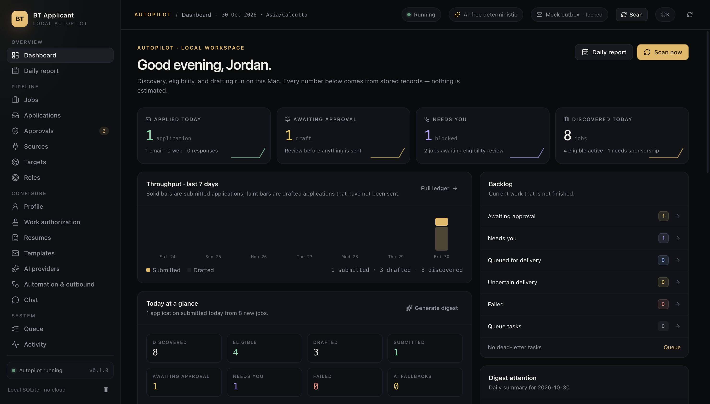

# BT Applicant

A local-first job discovery and application desk for macOS. It polls public job sources, decides whether a role is legally reachable for you, scores it, drafts an application, and delivers it only after your approval. Everything runs on your Mac: SQLite, the queue, the scheduler, resumes, and the outbox.



## What it does

- **Discovery** from 14 connectors: Greenhouse, Lever, Ashby, SmartRecruiters, Workable, Remotive, Arbeitnow, Jobicy, Himalayas, Remote OK, The Muse, Adzuna, USAJOBS, and schema.org `JobPosting` pages.
- **Work authorization first**: citizenship, residence, and permits are modelled separately; EU/EEA/Switzerland free movement, UK–Ireland, Trans-Tasman, Nordic, GCC, and Mercosur routes plus employer-sponsored routes for the US, Canada, UK, Germany, Netherlands, and Australia. Every rule cites a source. Unknown is never treated as eligible.
- **Evidence, not guesses**: an email application exists only when the posting quotes a recipient address. Sponsorship and right-to-work signals keep the exact sentence.
- **Deterministic core**: eligibility, scoring, drafting, and delivery never depend on AI. Ollama, Anthropic, OpenAI, Gemini, and OpenAI-compatible endpoints are optional overlays with circuit breakers and a simulated-outage test mode.
- **Durable queue**: leased tasks, bounded retries with jitter, dead-letter, idempotent dispatch, crash recovery, schedules that catch up after sleep.
- **Local resume reading**: PDF, DOCX, TXT, Markdown, and RTF files are copied into the managed folder, extracted on-device, and parsed deterministically into contact details, summary, skills, dated roles with bullets and technologies, education, certifications, languages, projects, and awards. You review every field before importing; import only fills blanks and merges skills and languages, never overwriting existing profile data.
- **Role targeting and recommendations**: choose from 20 role families or add custom titles. Selected titles expand discovery queries and job scoring without changing eligibility. The recommendation screen ranks roles against your resume, profile, certifications, and jobs already discovered in your target countries, shows the evidence behind each score, and opens with a plain-language disclaimer. No AI provider and no network call are involved.
- **Safe delivery**: mock `.eml` outbox by default, kill switch on, human approval required, daily and per-company caps, transactional outbox.
- **Chat control, without a model**: connect Telegram through the official Bot API or WhatsApp through the official Cloud API. Receive event notifications, ask for status, pause or resume automation, fix missing profile facts, and prepare approvals, rejections, or retries. Approve, reject, and retry always need a six-digit, single-use, five-minute confirmation code. Commands are matched deterministically and work with AI switched off.
- **20 pages**: 18 pages in the navigation plus job and application detail, covering dashboard, daily report, jobs, applications, approvals, sources, targets, roles, profile, authorization, resumes, templates, AI, automation, chat, queue, activity, and diagnostics. A ⌘K palette reaches every page and the quick actions.
- **Daily reporting**: what was discovered, drafted, submitted, and what needs you, plus an archived digest.

## Quick start

Requirements: macOS on Apple silicon, Node 22 or newer. The app uses the built-in `node:sqlite`, so there is no native module to rebuild.

```bash
pnpm install
pnpm dev
```

First run opens a five-step onboarding: identity, work authorization, targets, resume, review. Nothing is discovered or sent until you finish it.

> Safety default: outbound is mock-only and kill-switched. A fresh install can write `.eml` files to the local mock outbox but cannot send email. SMTP must be configured, verified, and unlocked explicitly on **Automation & outbound**.

## Commands

| Command | Purpose |
| --- | --- |
| `pnpm dev` | Development app with hot reload |
| `pnpm build` | Build main, preload, and renderer into `out/` |
| `pnpm typecheck` | TypeScript for both process and renderer |
| `pnpm test` | Unit and integration tests (Vitest) |
| `pnpm test:e2e` | Build, seed the E2E fixture, run the Playwright Electron walkthrough, regenerate screenshots |
| `pnpm verify:sources` | Read-only live check of every connector; writes `docs/SOURCE-VERIFICATION.md` |
| `pnpm package:mac` | Unsigned `.app` in `release/mac-arm64` |
| `pnpm verify:packaged` | Launch the packaged app with fresh user data and assert schema, defaults, and zero renderer errors |
| `pnpm dist:mac` | Unsigned DMG and ZIP for arm64 |

## Where data lives

Everything is under Electron's user-data directory:

```
~/Library/Application Support/BT Applicant/
  bt-applicant.db      SQLite database (WAL)
  logs/app.log         Rotating local log, redacted
  resumes/             Uploaded resume copies
  mock-outbox/         Mock .eml files
```

Secrets (SMTP password, AI keys, Telegram bot token, WhatsApp access token, verify token, and app secret) are encrypted with the macOS Keychain via Electron `safeStorage`. The database itself is not encrypted; use FileVault. Chat is off by default.

## Documentation

- [Research and sources](docs/RESEARCH.md)
- [Architecture](docs/ARCHITECTURE.md)
- [Decisions and trade-offs](docs/DECISIONS.md)
- [Reliability and recovery](docs/RELIABILITY.md)
- [Security and threat model](docs/SECURITY.md)
- [Test report and screenshots](docs/TEST-REPORT.md)
- [Source verification](docs/SOURCE-VERIFICATION.md)
- [Original plan](docs/PLAN.md) (historical; see Decisions for implementation deviations)

## Packaging status

The checked-in build produces an **unsigned** arm64 app. It runs locally but is not ready for public distribution: a release build needs a Developer ID signature, hardened runtime, and notarisation. The steps are in [SECURITY.md](docs/SECURITY.md#13-packaging-and-distribution).

## Scope and honesty

- One user, one machine. There is no server, account system, sync, or telemetry.
- Automation runs only while the app is open. Schedules catch up on the next launch; they do not run during sleep.
- No CAPTCHA solving, login automation, or scraping of pages that forbid it. Web applications open in a guided window and are submitted by you.
- Work authorization rules are a decision aid, not legal advice. Review the cited rule and your permit before applying.
- AI is optional and cannot change eligibility or send anything.
- Chat is optional. Telegram needs a bot token from @BotFather. WhatsApp needs a Meta app, a permanent access token, and a public HTTPS tunnel to the loopback webhook; the app does not create or host the tunnel. Notifications leave the machine through the channel you enable.
